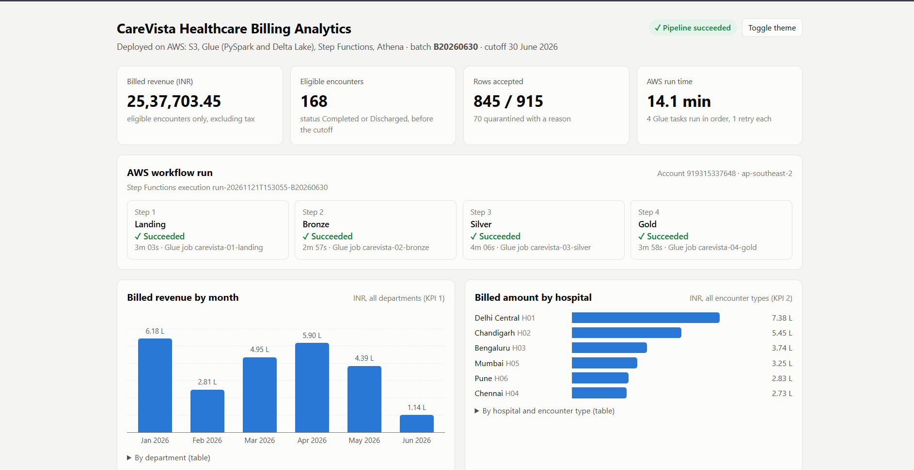
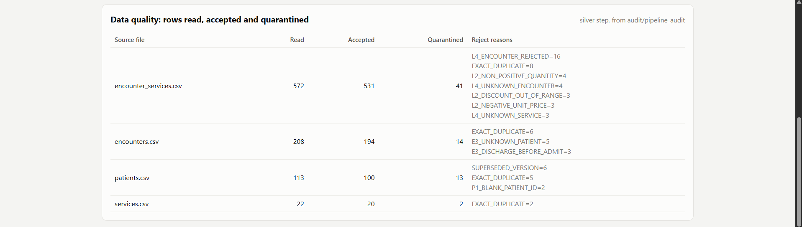
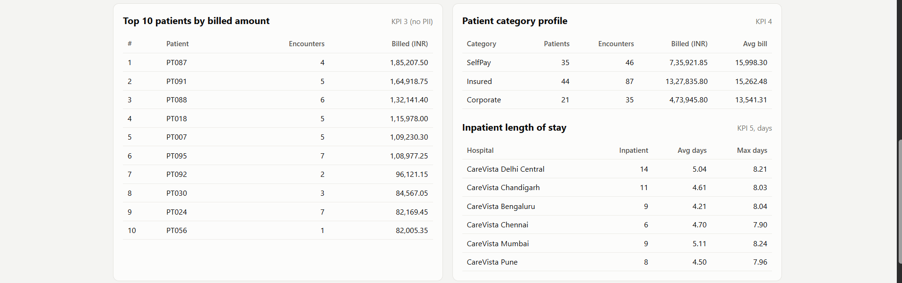
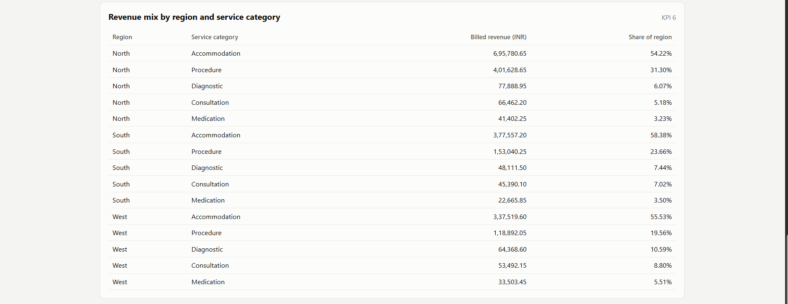
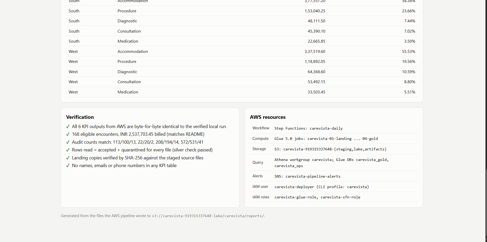

# CareVista Healthcare Billing Analytics

A data pipeline that turns four messy hospital extracts into clean tables and six KPIs for the finance and operations teams of CareVista Health Network (6 hospitals, North, South and West India).

```
 staged CSVs ──► LANDING ──► BRONZE ──► SILVER ──────────► GOLD
 (unchanged)     exact copy   raw text   cleaned rows       star schema + KPIs
                 + SHA-256    + batch_id      │
                              + source_file   └──► QUARANTINE (bad rows + reason)
                              + row number
                                   all steps ──► AUDIT (rows read / accepted / rejected, run history)
```

- **Cloud:** Azure (ADLS Gen2 + Azure Databricks + Delta Lake + Data Factory). See [docs/AZURE_DEPLOYMENT.md](docs/AZURE_DEPLOYMENT.md).
  **Also deployed on AWS** (S3 + Glue + Delta Lake + Step Functions + Athena). See [docs/AWS_DEPLOYMENT.md](docs/AWS_DEPLOYMENT.md).
- **Code:** Python (PySpark) for the cleansing, SQL for the KPIs.
- **Storage format:** Delta Lake for every table.
- **Runs locally too:** the same code runs on your laptop with local Spark, and **126 automated tests pass** (see [docs/TEST_REPORT.md](docs/TEST_REPORT.md)).

## Results (batch B20260630, cutoff 30 June 2026 23:59:59)

| File | Rows read | Accepted | Rejected |
|---|---|---|---|
| patients.csv | 113 | 100 | 13 |
| services.csv | 22 | 20 | 2 |
| encounters.csv | 208 | 194 | 14 |
| encounter_services.csv | 572 | 531 | 41 |

- 168 eligible encounters, billed revenue **INR 2,537,703.45**.
- All six KPI tables: [reports/kpi_report.html](reports/kpi_report.html) (open in a browser) or [reports/kpi_report.md](reports/kpi_report.md), plus one CSV per KPI in [reports/](reports/).

| KPI | Table | Output columns |
|---|---|---|
| 1. Billed revenue by department per month | `gold/kpi1_revenue_by_department_month` | month, department, billed_revenue |
| 2. Encounters and average bill by hospital and type | `gold/kpi2_hospital_encounter_type` | hospital_id, encounter_type, eligible_encounters, billed_amount, average_bill |
| 3. Top ten patients by billed amount | `gold/kpi3_top10_patients` | rank, patient_id, eligible_encounters, billed_amount |
| 4. Patient category profile | `gold/kpi4_patient_category_profile` | patient_category, patients, patients_with_eligible_encounters, eligible_encounters, billed_amount, average_bill |
| 5. (stretch) Inpatient length of stay by hospital | `gold/kpi5_inpatient_length_of_stay` | hospital_id, hospital_name, inpatient_encounters, avg/max_length_of_stay_days |
| 6. (stretch) Revenue mix by region and service category | `gold/kpi6_region_service_category_mix` | hospital_region, service_category, billed_revenue, share_of_region_pct |

## Final output (AWS run dashboard)

Screenshots of the dashboard built from the files the AWS pipeline wrote to S3 (Step Functions run of batch B20260630).

**Headline numbers, the four Glue steps, KPI 1 (revenue by month) and KPI 2 (billed amount by hospital)**



**Data quality: rows read, accepted and quarantined per file, with reject reasons**



**KPI 3 (top 10 patients), KPI 4 (patient category profile) and KPI 5 (inpatient length of stay)**



**KPI 6 (revenue mix by region and service category)**



**Verification checks and the AWS resources used**



## Read next

| Document | What is in it |
|---|---|
| [docs/PROJECT_OVERVIEW_AND_ARCHITECTURE.md](docs/PROJECT_OVERVIEW_AND_ARCHITECTURE.md) | **Start here:** what the project requires, the full architecture, and how every part works |
| [docs/CLEANSING_RULES.md](docs/CLEANSING_RULES.md) | Every rule (P1-P3, S1-S2, E1-E4, L1-L4), what it does, and how many rows it caught |
| [docs/ASSUMPTIONS_AND_IMPACT.md](docs/ASSUMPTIONS_AND_IMPACT.md) | Our assumptions, and how much money and how many rows the rejected records represent |
| [docs/AZURE_DEPLOYMENT.md](docs/AZURE_DEPLOYMENT.md) | Step-by-step Azure set-up, the Data Factory workflow, and how to collect run evidence |
| [docs/TEST_REPORT.md](docs/TEST_REPORT.md) | What the tests check, and the latest results |
| [evidence/](evidence/) | Logs of a first run, a rerun of the same batch, and a failed task followed by a successful retry |

## Run it on your computer

You need Linux, macOS or Windows with WSL (Ubuntu). No admin rights needed.

```bash
# 1. One-time set-up: Python packages in ~/hc-venv and Java 17 in ~/jdk17
bash scripts/setup_env.sh

# 2. Run the whole pipeline (landing -> bronze -> silver -> gold) and write the report
./scripts/run_local.sh B20260630

# 3. Run it again with the same batch: nothing is duplicated, results are identical
./scripts/run_local.sh B20260630

# 4. Optional: make the silver task fail once, to see the retry work
./scripts/run_local.sh B20260630 --fail-once silver

# 5. Run all tests
./scripts/run_tests.sh
```

On Windows you can use `.\scripts\run_local.ps1` and `.\scripts\run_tests.ps1` from PowerShell; they call WSL for you.

The pipeline takes two parameters, as the brief asks: `--input-path` (folder with the four CSVs) and `--batch-id`. `--lake-root` says where the zones are written (a local folder, or `abfss://...` in Azure).

## How the requirements are met

| Requirement | Where |
|---|---|
| Copy the four files unchanged into landing | `landing.py`: byte copy, then SHA-256 of source and copy compared |
| Keep the original files unchanged | Originals in the project root are never written; the pipeline reads copies in `data/source/`; a test compares their hashes |
| bronze → silver → gold with SQL and PySpark | `bronze.py`, `silver.py` (PySpark), `gold.py` + `sql/*.sql` (Spark SQL) |
| `batch_id` and `source_file` on every bronze row | Plus `source_row_num`, so each row can be found in its file |
| Parameterised input path and batch_id | CLI flags locally; ADF pipeline parameters → notebook widgets in Azure |
| Gold and quarantine written with overwrite | `io.write_overwrite`; bronze and audit replace only their own batch |
| Audit of rows read / accepted / rejected per file | `audit/pipeline_audit`; the silver step fails if read ≠ accepted + rejected |
| Star schema | `dim_patient`, `dim_service`, `dim_hospital`, `fct_encounter`, `fct_billing_line` |
| Four required KPIs + two stretch KPIs | `src/carevista/sql/kpi1..kpi6*.sql` |
| No names, email or phone in KPI output | PII stays in silver; gold has none (checked by a test) |
| Workflow with 3-4 ordered tasks, 1 retry each | ADF `pl_carevista_daily` (4 activities, `retry: 1`); local runner `pipeline.py` does the same |
| Rerun of the same batch gives the same result | Tested: every bronze/silver/quarantine/gold table and the audit counts are compared before and after a rerun |
| Failed run then successful retry (optional) | `--fail-once silver`; tested and logged in `evidence/run3_failure_then_retry.log` |
| Run history and row counts as evidence | `audit/run_history` (every attempt) and the report; ADF Monitor in Azure |
| Failure alert (optional) | Azure Monitor alert on `PipelineFailedRuns` (described in the deployment guide) |

## Project layout

```
Healthcare_Analytics_UseCase.docx, *.csv   original files as supplied (left untouched)
data/source/                 staged copies of the four CSVs (the pipeline input)
src/carevista/
  config.py                  file names, expected columns, cutoff, allowed values, paths
  rules.py                   reusable cleansing functions (dates, amounts, categories, line charge)
  landing.py  bronze.py  silver.py  gold.py     the four pipeline tasks
  sql/kpi1..kpi6*.sql        KPI queries (Spark SQL / Databricks SQL)
  audit.py                   audit and run-history tables
  pipeline.py                local workflow runner (order, retry, run history)
  report.py                  KPI report as CSV, Markdown and HTML
  io.py  spark.py            storage and Spark helpers
notebooks/databricks/        one notebook per task, used by Data Factory
orchestration/adf/           Data Factory pipeline + Databricks linked service (JSON)
sql/databricks/              register tables + evidence queries for Databricks SQL
tests/                       126 tests, incl. an independent pandas version of the rules (oracle.py)
scripts/                     set-up, run and test helpers
docs/                        rules, assumptions, deployment, test report
reports/                     KPI outputs from the latest local run
evidence/                    run logs and test results
lake/                        local data lake created by a run (not needed in Git)
```
